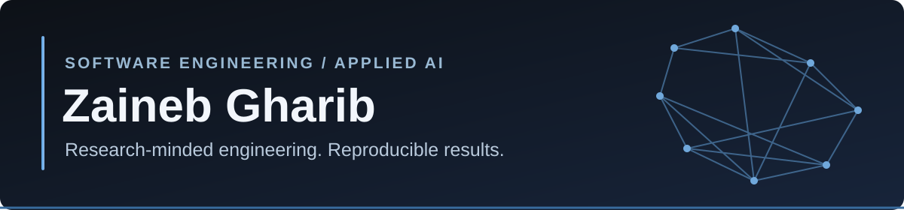

I'm a final-year **Software Engineering student at Sichuan University**, interested in applied artificial intelligence, computer vision, data analysis, and building dependable software systems.

My projects bring together research and engineering: from evaluating deep learning models for medical images to developing bilingual analysis tools and full-stack applications. I value **reproducible experiments, clear technical documentation, and honest reporting of results and limitations**.

## Selected research

| Project | Focus | Evidence |
| --- | --- | --- |
| **[From Slices to Volumes: 2D, 2.5D & 3D CT Study](https://github.com/CT-DeepLearning-Team/CT-2D-2.5D-3D-DeepLearning)** | Team comparison of image representations for pulmonary nodule malignancy-*risk* classification. I worked on the **3D model track**. | Implementations, experiment metrics, figures, and research manuscript. |
| **[BUS-BRA Granular Computing](https://github.com/Granular-Breast-Cancer-Team/BUS-BRA-Granular-Computing)** | Team research on radiomic feature selection with SVM and fuzzy-rough methods. | Documented GBFRS evaluation; the complete comparison across methods is ongoing. |

## Selected engineering work

| Project | Highlights |
| --- | --- |
| **[Bilingual Industrial Incident Analyzer](https://github.com/Zaineb-Gharib/bilingual-industrial-incident-analyzer)** | English/Chinese incident analysis, structured validation, evidence checks, prompt-strategy comparison, and reproducible **offline demo** evaluation. Live-provider evaluation remains pending. |
| **[Healthcare Patient Management System](https://github.com/Zaineb-Gharib/db-Project)** | Demonstration application using Next.js, TypeScript, React, and MySQL, with role-based workflows and documented setup and tests. |
| **[Yelp Analytics & Hive Copilot](https://github.com/Zaineb-Gharib/yelp-analysis-project04)** | Yelp data analysis notebooks and charts, SQL work, and a Streamlit/React analytics interface with a **mock-first** backend. |

## Technical focus

**Programming & software:** Python · TypeScript · SQL · React · Next.js · FastAPI · Streamlit · MySQL  
**Research & analysis:** Machine learning · Computer vision · Experimental evaluation · Data visualization · Reproducibility

## Team collaborations

- [CT-DeepLearning-Team](https://github.com/CT-DeepLearning-Team) — collaborative medical imaging research.
- [Granular-Breast-Cancer-Team](https://github.com/Granular-Breast-Cancer-Team) — collaborative granular computing research.

---

*Interested in software engineering, applied AI, and research opportunities. Explore the linked repositories for methods, code, results, and limitations.*
